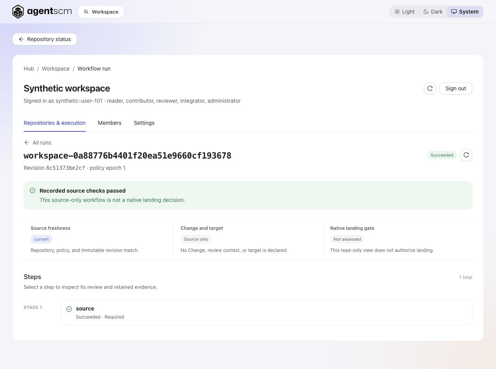
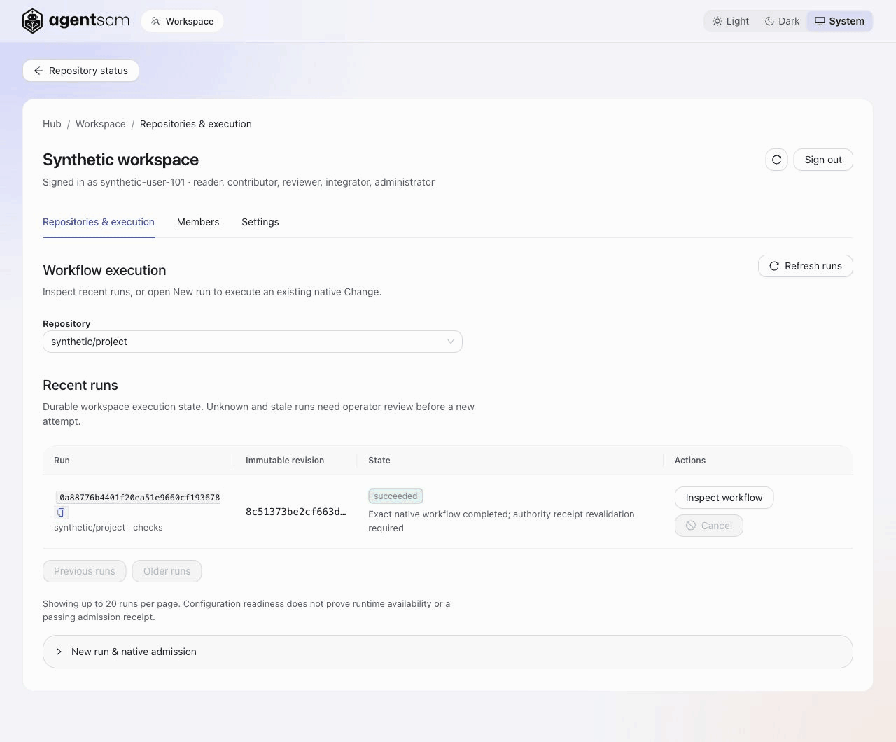

<h1>
  <picture>
    <source media="(prefers-color-scheme: dark)" srcset="docs/assets/agentscm-logo-dark.png">
    
  </picture>
</h1>

**Source control for teams of coding agents.**

AgentSCM combines a native source-control engine with a self-hosted coordination Hub.
It records exact source revisions, the checks and reviews applied to them, and the
approvals that permit native landing.

Start alongside your existing **Git repository, editor and GitHub or GitLab workflow**
for collision warnings and shared work intents. You do not have to migrate a repository
to use coordination. Native workflows and landing controls are a separate, opt-in alpha.

> **Alpha: try it, don't depend on it.** APIs and storage may change without migration.
> Native workflows are experimental; production security and scale are not qualified.

## Why AgentSCM?

When you and a teammate each run several agents, separate worktrees keep edits apart,
but you still need to know who is touching the same files and which checks apply to
what will land. You should not need to build a frontier lab's development infrastructure
to start coordinating that work.

AgentSCM connects three parts of that process:

- **Coordinate work before a merge.** See announced agent activity across machines,
  spot overlapping files and PRs, and request a handoff. Supported hooks refuse the
  first contested edit once with a reason; a repeat passes.
- **Keep checks attached to exact source.** In the experimental native workflow,
  pinned tests and bounded Claude Code review evaluate an immutable revision.
  Failures return for fixes; new bytes require fresh qualifying evidence.
- **Make native landing a deliberate decision.** Required evidence, human approval
  and the current target are rechecked at the native landing boundary. A green
  historical run is not permission to land a different revision.

## Quickstart

| Your starting point | Use AgentSCM for | Start here |
|---|---|---|
| Existing Git repository | Local collision checks; no Hub or account required | Demo below, then [collision checks](docs/collisions.md) |
| Agents on several machines | Shared work intents, contested-file notices and handoffs | [Two agents, one warning](docs/two-agent-demo.md) |
| Native workflow pilot | Revision-bound tests/review, explicit approval and native landing | [Claude Code workflow loop](docs/advanced/claude-code-workflows.md) |

For packaged binaries or containers, see [install options](docs/install.md).

**Install: local or hosted?** For the alpha, run it on your own machine: `npx agentscm --local`.
A hosted hub for a team is unsupported in the alpha and will likely break; `npx agentscm --hosted`
prints the [hosted guide](docs/hosted.md) to work through with your coding agent. Asked to
install AgentSCM for someone? Ask them "local or hosted?" first, then follow
[choose local or hosted](docs/install.md#choose-local-or-hosted).
Building from source? Without the `ui` feature the hub serves only a notice page at `/ui/`; for the
real status page run `(cd ui && npm ci && npm run build) && cargo build --locked --features ui`.

Joining an existing Hub? Use **Connect an agent** in its status page. Your agent guides sign-in,
native approvals and verification; readiness requires recent MCP and native edit-hook observations.
See [member onboarding](docs/team-member-onboarding.md#verify-trust-and-behavior).

## Try it

From a Git repository:

```sh
npx agentscm demo
```

This starts a temporary local Hub, simulates three agents through its real hook endpoint,
and opens the status page. No account, Docker or forge is required; nothing is written
to your repository. The agents and their decisions are scripted. Press Ctrl-C to stop.

For your own agents, run `npx agentscm` for guided setup, or follow the
[setup guide](docs/setup-guide.md). Existing configuration changes are shown before
confirmation. The [agent guide](docs/agents.md) distinguishes native hooks, advisory MCP
and client qualification; coordination support is broader than workflow execution support.
Generated instructions also guide [selective source use](docs/advanced/agent-source-workflow.md)
at task start and dependency expansion, using a configured native store or a dedicated sparse
Git worktree. Rerun `init-repo` to review the updated instruction block; hooks still handle
coordination, and selection does not narrow required checks or establish model-cost savings.

Quickstart sets up each coding agent through `agentscm client setup`, so it appears on the
hub's Connect agents page, defaults to a native managed hub on Apple Silicon macOS with an explicit Docker fallback, and prints the executable path and PATH guidance for later commands.
See [guided setup](docs/setup-guide.md) for details.

## The native workflow loop

The experimental native engine adds a controlled path from a change to landing:

```text
Edit -> checkpoint -> tests -> review -> human approval -> native landing
 ^                      |         |
 +-------- fixes -------+---------+
```

The configured workflow runs against exact source and retains step evidence. Tests or
required review failures return feedback; fixes create a fresh revision. Approval and
landing are separate actions, and native admission rejects missing or stale required
evidence. An optional Claude Code Stop hook triggers the loop; the authority enforces
the landing requirement even if that hook is skipped.

Use the [local workflow guide](docs/advanced/claude-code-workflows.md) or the experimental
[Community workspace](docs/advanced/community-workspace.md) for shared execution,
independent member roles, run inspection and explicit approval/integration. The
[laptop-to-hosted guide](docs/advanced/hosted-laptop-workflows.md) covers the opt-in native
source transfer profile. These are trusted-team alpha paths, not a finished hosted service.
For repeated local graphs, the [reusable workflow library](docs/advanced/reusable-workflows.md)
binds one explicit, versioned manifest from immutable native source to an existing Change.

## Inspect work and evidence in the Hub

The Hub shows agent coordination and, when configured, workflow runs, source freshness,
retained step evidence and workspace permissions.
Its [work insights](docs/work-insights.md) API exposes bounded reported duration,
partial usage reports and stored publication observations without turning them into approval or landing claims.

<a href="docs/assets/hub-workflow.jpg">
  
</a>

<sub>Running local Hub with synthetic data. This example checks source paths; it does
not demonstrate model review, CI/CD or a native landing decision.</sub>

<details>
<summary>Watch the Hub walkthrough and open full-size screenshots</summary>



[Runs](docs/assets/hub-workspace.jpg) · [Workflow](docs/assets/hub-workflow.jpg) ·
[Evidence](docs/assets/hub-evidence.jpg) · [Members](docs/assets/hub-members.jpg)

The 17-second loop is a sequence of actual screenshots. The UI is an early prototype;
pagination, large histories, search and navigation still need substantial refinement.

</details>

## Git, GitHub and GitLab

Keep Git and your forge in charge of their existing merge path. Experimental bridges
already capture clean Git commits, reconcile changes, export native source to Git mirrors,
and exchange with remotes over authenticated HTTPS or SSH.

The attached-checkout lifecycle can bind an exact native Change, require its current configured evidence, build a typed unlanded candidate in an owned mirror, and deliberately publish a separate branch and a GitHub PR or GitLab MR through the existing Mirror transport and Hub bridge. Qualification uses synthetic checkouts, local/loopback HTTPS transport and in-process fake GitHub or GitLab; live forge and attached SSH use are not qualified. GitLab MR publication for these candidates is fake-tested only, covers no event publication (its opt-in workflow status is also fake-tested only), and is not full-history migration or native authority cutover. Native landing controls do not enforce raw Git pushes or forge merges.

See [Git exchange](docs/advanced/git-remote-network.md) and the [roadmap](docs/roadmap.md).
Moving authority from Git to the native ledger is a separate, proposed per-target cutover.

## What works today

| Capability | Current boundary |
|---|---|
| Git collision checks | Read-only branch/worktree checks; same-file overlap is not proof of conflict |
| Hub, intents and coordination hooks | Cross-machine announced work; hooks fail open and contested-edit refusal is once per session/file |
| Agent handoff | Experimental request/reply flow; see [handoff](docs/hub.md#handoff) |
| Native source and workflows | Experimental immutable revisions, pinned command checks, bounded Claude Code review, authenticated agent-task collection and exact-revision native landing requirements |
| Community workspace | Experimental single-server pilot: persistent members/settings, independent permissions and one serial workflow queue |
| Git bridges and forge integration | Experimental; see the Git section above for transport and provider limits |

The legacy token dashboard and `agentscm_workflow_status` MCP tool inspect retained
workflow runs; they do not grant execution or landing authority. See the
[changelog](CHANGELOG.md) for known limits.

## Trust and operating limits

- **Coordination is not locking.** Hooks fail open when unavailable. Only announced work
  is visible; semantic conflicts and unannounced shell edits can go undetected.
- **Native admission and Git protections are distinct.** Native requirements bind source,
  context, policy and target. Your forge needs its own configured merge protections.
- **You run the Hub.** Hub data stays with the service you configure. This source also
  contains staged, configurable usage telemetry, but it cannot send until an endpoint and
  data-handling profile are configured. Review the [telemetry data and controls](docs/telemetry.md)
  and [what the Hub stores](docs/hub.md#data-the-hub-stores), including task text from agents.
- **One writer for the pilot.** Shared native execution requires the documented Unix/runtime
  setup, persistent storage and explicit recovery. No automatic failover or production
  security/scale qualification is claimed.
- **Back up native state separately.** Git exports preserve source, not workflow/approval
  state. Follow the [consistent backup guidance](docs/advanced/community-workspace.md#operations-and-recovery).

## Documentation and contributing

[Documentation index](docs/README.md) · [Install](docs/install.md) ·
[Supported agents](docs/agents.md) · [Hub setup](docs/hub.md) ·
[Deployment](docs/deployment.md) · [CLI reference](docs/reference/cli.md) ·
[Architecture](docs/architecture.md) · [Roadmap](docs/roadmap.md)

Packaged versions and notes are in [Releases](https://github.com/counterbranch/agentscm/releases).
These docs describe the branch/tag you are viewing; newer `main` features may require a
source build. Use your release tag's documentation for packaged binaries.

Contributions are welcome; read [CONTRIBUTING](CONTRIBUTING.md) and [SECURITY](SECURITY.md).
For hosted Hub interest or setup help: support@counterbranch.com.

## License

AgentSCM is source-available under FSL-1.1-ALv2. See [LICENSE](LICENSE) for its terms.

## Stability and contributing

AgentSCM is alpha: any release may change the CLI, the HTTP API and the on-disk
storage format, and no migrations are promised. The Rust toolchain pinned in [rust-toolchain.toml](rust-toolchain.toml)
is also the minimum supported version. Maintained by the [Counterbranch](https://counterbranch.com)
maintainers. See [CONTRIBUTING](CONTRIBUTING.md), [SECURITY](SECURITY.md) and the
[Code of Conduct](CODE_OF_CONDUCT.md). Building from source is for contributors: `cargo build --locked`
with that toolchain and `git` 2.45.0 or newer; `agentscm collisions` itself needs Git 2.43 or newer.

AgentSCM and Counterbranch are trademarks of DUVATL, Inc. The license does not
grant permission to use these names or logos; see TRADEMARKS.md.
GitHub, GitLab, Docker, Claude Code and other names are trademarks of their
respective owners and are used here only to describe compatibility.
