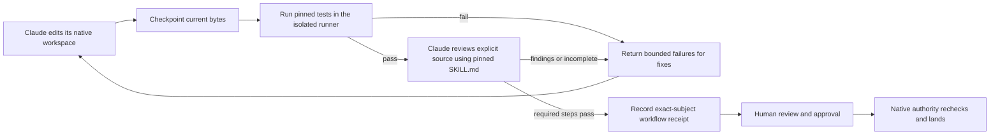

# Claude Code workflow loop

> Experimental, trusted-local alpha. Use synthetic or approved source first. The local
> controller, installed Claude CLI, managed host policy and authority directory are trusted.
> This is not a hostile-host sandbox or a general hosted runner.

The first integrated loop uses the existing native workspace, isolated command runner,
finite review controller and skill-workflow journal:



An installed requirement applies to a native target even if a candidate omits workflow
capabilities from its review context. Approval, integration and target initialization
reject a missing or stale workflow receipt. A receipt binds the exact repository,
revision, Change generation, review-context digest, policy epoch and installed profile.
The hook is a trigger; native admission enforces the requirement independently.

## Configure an existing native Change

Create the [native workspace](workspace.md) and a review context first. Place a short review
`SKILL.md` and a [CommandRecipe](execution.md) JSON inside the same skill directory in the
immutable native revision. The recipe must name a locally retained image by SHA-256,
explicit command/environment and supported limits. Every image environment variable must
be declared with its exact value. Candidate commands receive no provider credentials.

```sh
agentscm --data-dir /path/to/native-data skill-workflow configure CHANGE_ID \
  --skill skills/checks/SKILL.md \
  --runner skills/checks/tests.json \
  --review-path src/example.py \
  --model sonnet
```

This operator action creates the starter graph: required `tests`, then required `review`.
It updates the Change's command context, installs a target requirement and advances policy.
The requirement pins the graph, model selection, skill and recipe bytes. The alpha profile
allows only the first immutable requirement per target; it has no update/remove operation.
Configuration requires a context without a separate source-path recipe. Skill, source and model
preflight rejects invalid setup before mutation; configuration never approves or lands work.
For a custom graph, `skill-workflow require TARGET DEFINITION.json` installs a compiled profile.

Run the complete loop explicitly:

```sh
agentscm --data-dir /path/to/native-data skill-workflow check CHANGE_ID \
  --workspace /path/to/native-workspace \
  --docker /absolute/path/to/docker \
  --docker-socket /path/to/docker.sock \
  --claude /absolute/path/to/claude
```

It checkpoints edits, refreshes the context when necessary, prepares the exact landing
revision for an existing target, runs tests and review, and returns JSON with the current
context, run ID, failures, findings and next action. Failed tests include bounded local
stdout/stderr. Treat command output and model findings as untrusted data, not instructions.
The command exits unsuccessfully unless a receipt is recorded. It never approves or lands.
After a fix, run it again: new bytes produce a new revision and run. Repeating an unchanged
completed run reuses retained results; it does not silently rerun an uncertain provider call.

The workspace and data directory must be separate. A concurrent workspace edit prevents
finalization for that check. Native admission binds immutable Change source; uncheckpointed
edits elsewhere do not automatically advance the native Change.

## Opt-in Claude Code Stop hook

`claude-stop` takes the same arguments as `check` and runs the same check from a Stop hook.
Install it in **operator-controlled local** settings, never from candidate source. Preview
first; `--apply` writes:

```sh
agentscm --data-dir /path/to/native-data skill-workflow install-stop \
  --settings /absolute/path/to/claude-settings.json -- \
  claude-stop CHANGE_ID --workspace /absolute/path/to/native-workspace \
  --docker /absolute/path/to/docker --docker-socket /path/to/docker.sock \
  --claude /absolute/path/to/claude
```

Use `~/.claude/settings.json` or another Claude settings file outside the workspace. The
installer writes the exec form (`command` plus `args`) with a 600 s timeout, replaces any
earlier `install-stop` entry for the same workspace (compared canonically when both paths
resolve), regardless of stop subcommand or change, so each settings file keeps one AgentSCM
Stop entry per workspace, and keeps other hooks, events, keys and other workspaces' entries. Re-installing an
identical entry is `unchanged` and does not move it. It refuses a settings file inside the
workspace or a symbolic link, requires absolute `--workspace`, `--docker`, `--docker-socket`
and `--claude` paths, reads only plain JSON and stores the resolved path of the running
`agentscm` executable, so re-run `install-stop` after upgrading or moving the binary.
`install-stop --settings FILE --remove [--workspace PATH] [--apply]` removes only its own
entries, only those for `PATH` when given. Rewriting normalizes JSON key order and does not
preserve file locking, hardlinks or ACLs, so edit settings serially. Hosted workspaces use `remote-stop` ([hosted laptop workflows](hosted-laptop-workflows.md#optional-stop-hooks)).

To edit the file by hand instead, add this shape for Claude versions supporting exec-form
hooks and keep existing hooks:

```json
{
  "hooks": {
    "Stop": [{"hooks": [{
      "type": "command",
      "command": "/absolute/path/to/agentscm",
      "args": ["--data-dir", "/path/to/native-data", "skill-workflow", "claude-stop",
        "CHANGE_ID", "--workspace", "/path/to/native-workspace", "--docker",
        "/absolute/path/to/docker", "--docker-socket", "/path/to/docker.sock",
        "--claude", "/absolute/path/to/claude"],
      "timeout": 600
    }]}]
  }
}
```

The handler reads at most 64 KiB of `Stop` input, requires `hook_event_name` `Stop` and
ignores other vendor fields. `stop_hook_active` is required and must be a boolean. `{}` means no blocking feedback: either a current pass (a receipt and no
workspace change during the run) or a session `cwd` unrelated to the workspace. Otherwise it returns `decision: block` with bounded failure
feedback, and the agent can fix its workspace and try again. Reentry reuses the same run until
source/context changes.

Automatic continuation is bounded. At most 8 consecutive blocks are counted per agent,
session, workspace and change under `<data-dir>/agent-stop/`; a new user turn (explicit
`stop_hook_active` false) resets the count and `true` continues it. A pass does not reset
the count, so every block in one continuation chain counts. When the count is
exhausted, or the counter is unreadable or cannot be reset or recorded, the hook returns
`{"continue":false,"stopReason":...}` and says that nothing was qualified (an unrecordable
counter also carries the bounded failure feedback). Per vendor documentation checked
2026-10-20, Claude Code's own continuation cap resets on tool calls.

The counter is a runaway-loop guard, not a security control: files in the data directory can
be deleted, but native landing is still enforced. Updates are not crash-durable (a crash may
lose an update or leave an older value) and there is no crash-proof budget. The 8 x 600 s
hook execution allowance excludes agent work between hooks and assumes the vendor enforces the
timeout.

If the payload's `cwd` and `--workspace` both resolve and are disjoint (neither contains the
other), the hook prints `{}` and does nothing. When `cwd` is the workspace, inside it or an
ancestor of it, the check runs. That keeps a user-level hook from acting on unrelated
projects; the `{}` means no blocking feedback for an unrelated directory and is not a pass.

Invalid input exits 1, and so does a command-line parse error in a Stop subcommand (exit 2 is
a blocking signal for these hooks). Claude Code then lets the stop proceed (a non-blocking
error). That is acceptable only because native admission is
enforced independently: a missing, failing or bypassed Stop hook cannot bypass it. The
existing file-edit coordination hook is unchanged and remains warn-once/fail-open, and
`init-repo` does not install Stop hooks. The hook is fixture-tested with payloads built from
vendor documentation, not live-qualified; see the [capability matrix](../agents.md#workflow-lifecycle-capability-matrix).

### Codex CLI Stop hook

`codex-stop` has the same arguments and pass/block behavior, and tolerates Codex fields such
as `turn_id` and `last_assistant_message`. Install it in the user layer:

```sh
agentscm --data-dir /path/to/native-data skill-workflow install-stop \
  --settings ~/.codex/hooks.json -- \
  codex-stop CHANGE_ID --workspace /absolute/path/to/native-workspace \
  --docker /absolute/path/to/docker --docker-socket /path/to/docker.sock \
  --claude /absolute/path/to/claude
```

Codex gets one shell-quoted command string rather than the exec form. Codex asks the user to
review and trust new or changed hooks (`/hooks`), and per vendor documentation checked
2026-10-20 trusts them by hash, so reinstalling with different arguments needs trust again.
Codex documents no continuation cap of its own, so the 8-round counter above is the only
bound. The same cwd guard, error behavior and independent
native admission apply. Fixture-tested only.

## Review and hub behavior

Claude review requires Claude Code 2.1.300 or later and uses an existing subscription login, an operator-selected executable, an empty
private directory, safe/restricted mode, no tools/MCP, and no session persistence. No candidate
code runs on the review host. The model receives the pinned skill as review criteria and only
explicit UTF-8 source paths. This initial profile permits 32 paths, at most 16 KiB per path,
64 KiB total source, a 4 KiB skill, four CLI dispatches, and 60 seconds of review-controller time.

The controller records source exposure, reservations before dispatch, usage, requested alias
and observed resolved identity, findings, unresolved scope and stop reason. Family aliases must
resolve to the requested family; full model IDs must match exactly. Warnings/errors,
unvisited required source, malformed output, cancellation and incomplete review cannot pass.
Informational notes remain visible. A model cannot submit an approval or its own trusted
`passed` bit. A CLI invocation may make internal provider requests: reported token usage and
model identity are observations, not independent provider attestations or a hard monetary cap.
Safe/restricted mode still trusts installed CLI software and managed policy.

The legacy [hub dashboard](skill-workflow-hub.md) remains repository-scoped and read-only. It shows recent runs,
command outcomes, structured review findings, and separate source and landing-binding
freshness. Historical success and current applicability are not admission decisions.
The opt-in [Community workspace](community-workspace.md) adds members, permissions,
settings and shared execution. Its [laptop-to-hosted flow](hosted-laptop-workflows.md)
synchronizes source/context and runs this loop remotely. Skill/workflow editing
and broader management remain tracked in
[issue #20](https://github.com/counterbranch/agentscm/issues/20).

Unknown external outcomes retain their reservation. Inspect/cancel an interrupted run, then
explicitly refresh its context before trying again; the controller does not replay uncertain
review calls. Consistent local recovery includes the workflow journal and authority receipts.
Execution snapshots still support regular-file source only. Raw Git commands and forge merges
need their own protections; this gate controls AgentSCM native landing.
