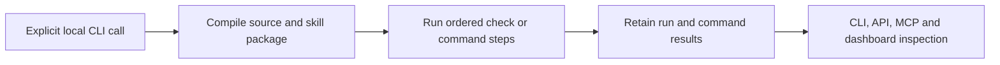

# Source-bound skill workflows

> **Experimental (alpha).** This local workflow profile has limited testing and its CLI,
> schema and storage may change without migration. It runs against an existing native AgentSCM
> data directory owned by the local operator.

A skill workflow binds a small directed graph of checks to one immutable native source revision
and one packaged `SKILL.md`. The package may include explicitly named resources below the skill
directory. AgentSCM preserves those bytes and includes their identity in the compiled plan; it
does not interpret the skill prose as authority, shell text or a successful check result.

The profile implements `source_paths` and, on Unix, `command`. `source_paths` reads exact files
from the selected native revision and compares their bytes with declared lowercase SHA-256
digests. This establishes source identity for those paths. It does not execute the source or
demonstrate application behavior.

A `command` action names a strict `CommandRecipe` JSON resource packaged beside `SKILL.md`. The
compiler loads that exact resource from the immutable revision and requires a real, existing,
current Change and `command/v1` ReviewContext that bind the same revision, policy epoch, recipe,
toolchain and environment. The runtime creates a deterministic durable command attempt and sends
it through the existing isolated OCI collector. It does not derive a command from skill prose,
install packages, run `npx`, fetch an image, expose model-provider keys or enable network egress.

`require_capability` records an operation the profile cannot perform. A required unavailable
capability blocks the run. An optional unavailable capability remains visible as an omission and
does not become a success; after all required work succeeds, the run reports
`completed_with_omissions`.

## What this is useful for

Use a workflow when a checkpoint needs the same ordered set of checks each time. The definition
names the exact revision, packaged resources and dependencies. The runner records what finished,
what failed and what was unavailable, so a restart does not turn an unknown command result into a
new execution or a success claim.

An operator or an agent acting through the local CLI starts it explicitly:



`SKILL.md` describes the skill; it is packaged input. A command step also needs the strict recipe
and actual review-context binding described below. Arbitrary skill prose is not an instruction to
launch an agent, install a package or execute a shell command.

## Agent hooks, execution and admission

The existing file-edit hooks coordinate contention and remain warn-once/fail-open. The optional
[Claude Code Stop loop](claude-code-workflows.md) separately checkpoints source, runs isolated
tests and bounded review, returns failure feedback, and records a current completion receipt.
The MCP workflow tool reads status; it does not start, resume or cancel a run. The bundled
[example skill](../../skills/native-workflow/SKILL.md) still covers source-path checks only.

Individual command evidence satisfies a requesting command context. An operator-installed
native target workflow requirement additionally requires every required step to pass, including
review, before approval or landing. This is checked in the authority transaction. A standalone
run remains an observation with `admission: "not_assessed"`; it is never an approval itself.
Catalog installation, other agent adapters and authenticated remote execution controls remain
planned. The native gate does not protect arbitrary Git or forge merge operations.

## Definition

Definitions are strict JSON: unknown fields are rejected. The repository ID comes from the
read-only native authority in `--data-dir`; the revision, policy epoch, skill paths, dependency
graph and source expectations must all validate before a plan is produced.

```json
{
  "version": 1,
  "name": "verify-native-source",
  "source": {
    "repository": "0123456789abcdef0123456789abcdef",
    "revision": "0000000000000000000000000000000000000000000000000000000000000000",
    "policy_epoch": 0
  },
  "skill": {
    "entrypoint": "skills/native-workflow/SKILL.md",
    "resources": []
  },
  "steps": [
    {
      "id": "verify-guide",
      "needs": [],
      "required": true,
      "action": {
        "kind": "source_paths",
        "expectations": [
          {
            "path": "docs/advanced/skill-workflows.md",
            "sha256": "0000000000000000000000000000000000000000000000000000000000000000"
          }
        ]
      }
    }
  ]
}
```

The entrypoint must end in the exact filename `SKILL.md`. Resource paths must be regular files
within its parent directory. The entrypoint is included automatically. AgentSCM reads every
declared skill file from the immutable revision, so it does not follow host filesystem paths.

For a command step, declare the recipe using its full native source path in `skill.resources`,
then use its path relative to the skill directory as `action.runner`. For example, a package with
`skills/native-workflow/SKILL.md` and a runner recipe file `skills/native-workflow/runner.json` (an example
path; this repository ships only `SKILL.md`) uses:

```json
{
  "skill": {
    "entrypoint": "skills/native-workflow/SKILL.md",
    "resources": ["skills/native-workflow/runner.json"]
  },
  "steps": [
    {
      "id": "run-command",
      "needs": [],
      "required": true,
      "action": {
        "kind": "command",
        "runner": "runner.json",
        "change": {
          "repository": "0123456789abcdef0123456789abcdef",
          "id": "change-1"
        },
        "change_version": 1,
        "context_digest": "0000000000000000000000000000000000000000000000000000000000000000"
      }
    }
  ]
}
```

Those `skill` and `steps` members belong inside the complete definition shown above. Replace all
placeholder identities with the current values from the same native data directory. Prepare the
strict recipe and ReviewContext as described in [isolated command execution](execution.md) and
[review contexts](review-context.md). One ReviewContext has one recipe binding; a workflow that
needs a different command recipe needs a separately bound current context.

Workflows contain 1 to 32 steps. Each step may name at most 32 dependencies, and a
`source_paths` action contains 1 to 32 expectations with an 8 MiB aggregate file-content limit and a separate 16 MiB encoded-object read ceiling. Step and
workflow identifiers are bounded canonical ASCII. Dependencies must exist, be unique and form an
acyclic graph. The compiler uses a stable topological order.

## Local CLI

Use the same existing native data directory that contains the source revision and authority:

```sh
agentscm --data-dir ./agentscm-data skill-workflow plan workflow.json
agentscm --data-dir ./agentscm-data skill-workflow run local-run-1 workflow.json
agentscm --data-dir ./agentscm-data skill-workflow status local-run-1
agentscm --data-dir ./agentscm-data skill-workflow resume local-run-1 --max-steps 1
agentscm --data-dir ./agentscm-data skill-workflow cancel local-run-1
```

`plan` validates the definition and reports its plan and skill identities without running steps.
`run` starts or reopens the named run and advances it by at most 32 steps. `resume` revalidates the
stored definition, native repository, revision, current policy epoch and packaged skill bytes
before continuing. A changed binding stops continuation; historical observations remain recorded.

Run IDs are idempotency keys. Reusing an ID with the same plan returns retained state. Reusing it
for a different plan is a conflict. Each completed step is persisted, so reopening the local data
directory preserves progress. Cancellation is terminal and leaves recorded observations intact.

Source-only workflows use the commands above unchanged. A workflow that can reach a `command`
step requires both trusted runtime flags on `run` and `resume`:

```sh
agentscm --data-dir ./agentscm-data skill-workflow run local-run-1 workflow.json \
  --docker /usr/local/bin/docker --docker-socket /var/run/docker.sock
agentscm --data-dir ./agentscm-data skill-workflow resume local-run-1 --max-steps 1 \
  --docker /usr/local/bin/docker --docker-socket /var/run/docker.sock
```

The flags are accepted only as a pair. Command execution is unavailable on non-Unix platforms;
source-only workflows remain portable. `SIGINT` and `SIGTERM` request collector cancellation and
cleanup. A process crash can still leave a running durable attempt. `status` exposes the command
attempt ID, generation, state, outcome and record digest under the step's `execution` member;
inspect its full record with the existing command-check CLI:

```sh
agentscm --data-dir ./agentscm-data check-command-show ATTEMPT_ID
agentscm --data-dir ./agentscm-data skill-workflow cancel local-run-1 \
  --docker /usr/local/bin/docker --docker-socket /var/run/docker.sock
agentscm --data-dir ./agentscm-data skill-workflow recover local-run-1 run-command \
  --docker /usr/local/bin/docker --docker-socket /var/run/docker.sock
```

Use `recover` only for an interrupted command step; its backend flags are required. Recovery
reconciles the retained container custody before finalizing the attempt and does not rerun the
command. While a command runs, other controllers can inspect its status. Cancellation and recovery
hold the workflow journal lease while reconciling container cleanup; concurrent journal operations
may return `workflow journal is active` during that bounded operation. Cancellation can omit the flags only when no command attempt is running. All command limits, isolation checks, cancellation behavior and recovery uncertainty are
the same as the underlying [`command/v1` collector](execution.md).

The JSON status includes `admission: "not_assessed"`. A successful workflow means only that its
implemented steps reached their declared success conditions. It does not approve, integrate,
merge, deploy or authorize the revision. The local owner, controller and Docker daemon remain
trusted. The optional required-target loop revalidates the graph and copies an exact-subject
receipt into native authority; read-only hub projections do not grant authority.

The compiler rejects more than 63 explicitly selected resources before source access; the automatic
`SKILL.md` makes 64 package entries. Relative package paths are limited to 512 bytes.

A partial `resume --max-steps N` may exit successfully while the JSON state is still `running`.
Inspect the state rather than treating process exit as workflow completion. A status read can
conflict with an active journal writer; retry after that operation finishes.

Local journal consistency checks bind retained definitions, ordered steps and observations. They
detect inconsistent records under the trusted local-owner model; they do not authenticate a
producer or prevent an owner from replacing coherent state. Recovery can finalize already-recorded
terminal steps after a policy change without rerunning source checks. Unfinished work still requires
the current source and policy bindings.

The native service exposes a [read-only run projection](skill-workflow-service.md) with historical
state separate from present source applicability.

For authenticated team access, configure the [hub/MCP read mapping](skill-workflow-hub.md) and use
the [dashboard run lookup](skill-workflow-ui.md). Execution and recovery remain local CLI operations.

Read-only access makes no workflow-row, execution, approval or integration changes and does not
initialize an absent journal or native store. SQLite may create or update WAL/SHM sidecars for
existing databases, including the native authority. Reads can fail if required sidecar housekeeping
is unavailable. This is logical read-only access, rather than a zero-filesystem-write guarantee.

Library callers using `advance(..., 0)` execute no new steps, but may reconcile an already
recorded all-terminal run outcome. The CLI accepts step budgets from 1 to 32.

## What the tests establish

The [workflow tests](../../tests/skill_workflow.rs) and
[command workflow tests](../../tests/command_checks/skill_workflows.rs) cover source and recipe
binding, graph dependencies, retained progress, failure propagation, context and policy drift,
concurrent-controller cancellation, lost-result recovery without replay, unknown cleanup and CLI
signal handling. Ordinary command cases use a fake Docker transport.

The opt-in `live_runtime_executes_the_exact_native_revision` test executes a fixed command through
the real container collector and verifies the native source bytes it sees. It needs an explicitly
selected Docker executable, socket and pre-acquired immutable image. The existing
[execution qualification](execution.md#qualification) covers the collector's tested isolation and
cleanup controls for its selected runtime.

The [Claude Code loop](claude-code-workflows.md) adds targeted failure/fix and native admission
tests. Fixture protocols alone do not qualify a live model or hostile execution. Catalog
installation, other agent adapters and deployment are not qualified by this profile.
